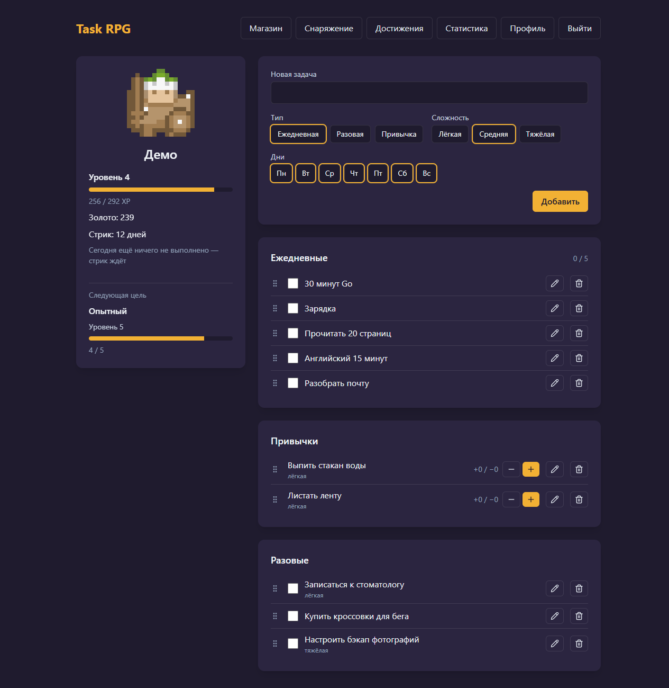

# Task RPG

Трекер задач с прокачкой персонажа. Выполняешь ежедневные и разовые задачи, отмечаешь привычки — и получаешь опыт и золото. Герой растёт в уровнях, покупает и надевает снаряжение, собирает достижения.



## Назначение

Обычный список дел не даёт ощутимой награды, поэтому его бросают через несколько дней. Здесь каждое выполненное дело видно на персонаже: растёт уровень, копится золото, на герое появляются новые вещи. Требования и решения по продукту описаны в [PRD](.claude/PRPs/prds/task-rpg.prd.md).

Что умеет приложение:

- **Задачи трёх типов.** Ежедневные (можно выбрать дни недели), разовые и привычки с кнопками «+» и «−». У задачи есть сложность: лёгкая даёт ×0.5 к награде, тяжёлая ×2.
- **Прогрессия.** XP и золото за каждую отметку, уровни по кривой с нарастающей сложностью, стрик дней подряд с бонусом к награде. Награда честная: снятая отметка забирает ровно то, что дала, и за день награждаются только первые 10 отметок.
- **Снаряжение.** Магазин из 32 вещей с открытием по уровню и 5 редких вещей за достижения. Надетые вещи сразу видны на пиксельном персонаже.
- **Достижения и статистика.** 13 вех с прогрессом, тепловая карта активности за 12 недель, доля выполненных ежедневок за 30 дней.
- **Профиль.** Можно сменить внешность героя, часовой пояс («сегодня» считается по нему) и пароль.

Стек:

| Слой | Технологии |
|---|---|
| Backend | PHP 8.4, Laravel 13 (JSON API), Sanctum (cookie-сессия SPA) |
| Frontend | Vue 3, TypeScript, Vite, Pinia, Vue Router, Tailwind CSS 4 |
| Хранилища | PostgreSQL 17, Redis 7 |
| Окружение | Docker Compose |
| Качество | Pest, Pint, Larastan (level 8), Oxlint + ESLint, Prettier, vue-tsc, Vitest, Playwright, GitHub Actions |
| Документация API | OpenAPI 3.1, генерируется из кода (Scramble) |

## Установка

Для запуска нужен только Docker с Compose. Node.js (`^22.18.0` или `>=24.12.0`) понадобится, если хочешь запускать проверки фронтенда и E2E-тесты на своей машине.

```bash
git clone https://github.com/MmGrand/taskRPGLaravel.git
cd taskRPGLaravel
docker compose up -d
```

Первый старт занимает несколько минут. Контейнер `app` сам ставит Composer-зависимости, создаёт `backend/.env` и ключ приложения, применяет миграции, засевает каталог предметов и создаёт демо-аккаунт. Контейнер `frontend` ставит npm-зависимости и запускает Vite.

| Что | Адрес |
|---|---|
| Приложение (SPA) | http://localhost:5173 |
| API | http://localhost:8000/api |
| Документация API | http://localhost:8000/docs/api |
| Health check | http://localhost:8000/api/health |
| PostgreSQL | `localhost:5432`, пользователь `task_rpg`, пароль `secret` |

Полезно знать:

- **Порты.** Если порт занят, задай `APP_PORT`, `FRONTEND_PORT` или `FORWARD_DB_PORT`, например `FORWARD_DB_PORT=5433 docker compose up -d`.
- **Демо-аккаунт.** `SEED_DEMO=false docker compose up -d` его не создаёт. Сид демо работает только при `APP_ENV=local` или `testing`, потому что пароль опубликован ниже.
- **После обновления репозитория** пересобери образ: `docker compose build app`. Скрипт запуска копируется в образ при сборке.
- **Открывай приложение по `localhost`, а не по `127.0.0.1`.** Cookie сессии выдаются для домена `localhost`, иначе вход упадёт с ошибкой 419 (CSRF).

## Быстрый старт

1. Открой http://localhost:5173 и войди: **`demo@example.com`** / **`demo-password`**.
2. У демо-героя 4-й уровень, стрик 12 дней и 5 достижений из 13. Отметь две ежедневки: над героем всплывёт награда, герой получит 5-й уровень, а в магазине откроются новые вещи.
3. Нажми «+» у привычки «Выпить стакан воды»: плюс даёт награду и продлевает стрик. «−» у «Листать ленту» только считается, «↶» снимает последнюю отметку.
4. Зайди в «Магазин», купи вещь и надень её на странице «Снаряжение».
5. Посмотри «Достижения», «Статистику» и «Профиль».

Свой аккаунт создаётся на http://localhost:5173/register: email, пароль, затем имя и внешность героя.

Демо создаётся при первом старте контейнера `app`. При каждом следующем старте его история сдвигается к сегодняшнему дню, поэтому стрик не прерывается. Пересоздать демо с нуля (другие аккаунты не затрагиваются):

```bash
docker compose exec postgres psql -U task_rpg -d task_rpg -c "delete from users where email = 'demo@example.com'"
docker compose exec app php artisan db:seed --class=DemoSeeder --force
```

## Примеры

### Работа с API через curl

API использует cookie-сессию Sanctum. Сначала нужно получить CSRF-cookie, а каждый изменяющий запрос должен идти с заголовком `X-XSRF-TOKEN` и `Origin` приложения. Полный список эндпоинтов — на http://localhost:8000/docs/api и в [backend/openapi.json](backend/openapi.json).

```bash
API=http://localhost:8000
ORIGIN=http://localhost:5173
JAR=cookies.txt
xsrf() { awk '$6 == "XSRF-TOKEN" { print $7 }' "$JAR" | sed 's/%3D/=/g'; }
call() { curl -s -b "$JAR" -c "$JAR" -H "Origin: $ORIGIN" -H "Accept: application/json" \
  -H "Content-Type: application/json" -H "X-XSRF-TOKEN: $(xsrf)" "$@"; echo; }

# CSRF-cookie, затем вход демо-пользователем
curl -s -c "$JAR" -H "Origin: $ORIGIN" "$API/sanctum/csrf-cookie"
call -d '{"email":"demo@example.com","password":"demo-password"}' "$API/api/login"

# Задачи пользователя
call "$API/api/tasks"

# Новая ежедневка на все дни недели и её выполнение
call -d '{"title":"Go, 30 minutes","type":"daily","difficulty":"medium","weekdays":[1,2,3,4,5,6,7]}' "$API/api/tasks"
call -X PUT "$API/api/tasks/<id задачи>/completion"
```

Ответ на выполнение содержит обновлённую задачу, героя и награду, например `"reward":{"xp":10,"gold":8,"capped":false}`. Точные числа зависят от сложности задачи и текущего стрика. Успешные ответы обёрнуты в `{ "data": ... }`, ошибки валидации приходят со статусом 422 в формате `{ "message", "errors" }`.

### Симулятор баланса

Проигрывает прогрессию по настоящим формулам и каталогу и показывает по дням, когда приходит каждый уровень и когда покупается каждая вещь:

```bash
docker compose exec app php artisan balance:simulate --tasks=5 --days=90 --difficulty=medium
```

Числа баланса лежат в [backend/config/progression.php](backend/config/progression.php) и [backend/config/habits.php](backend/config/habits.php).

### Проверки

Backend (внутри контейнера):

```bash
docker compose exec app composer lint           # Pint
docker compose exec app composer analyse        # Larastan
docker compose exec app composer test           # Pest
docker compose exec app composer test:coverage  # Pest + покрытие (минимум 80%)
docker compose exec app composer openapi        # обновить backend/openapi.json после изменения API
```

Frontend (в каталоге `frontend/`, после `npm install`):

```bash
npm run check:lint     # Oxlint + ESLint
npm run check:format   # Prettier
npm run type-check     # vue-tsc
npm run test:ci        # Vitest + покрытие (минимум 80%)
npm run build
```

E2E (в каталоге `frontend/`, при запущенном `docker compose up -d`):

```bash
npx playwright install chromium   # один раз: скачать браузер
npm run test:e2e
```

Главный тест проходит в браузере путь игрока: регистрация, герой, три задачи, новый уровень, покупка, надевание, выход и повторный вход. Второй проверяет, что открывается документация API. Каждый прогон оставляет в базе пользователя `e2e-…@example.test`. Удалить их:

```bash
docker compose exec postgres psql -U task_rpg -d task_rpg -c "delete from users where email like 'e2e-%@example.test'"
```

Те же проверки запускает CI (`.github/workflows/ci.yml`) на каждый PR и пуш в `main`. Кроме того, он падает, если закоммиченный `openapi.json` разошёлся с кодом или в зависимостях нашлась известная уязвимость (`composer audit`, `npm audit --omit=dev`).

## Структура проекта

```
taskRPGLaravel/
├── backend/                 # Laravel API
│   ├── app/
│   │   ├── Achievements/    # каталог достижений
│   │   ├── Console/         # artisan-команда balance:simulate
│   │   ├── Enums/           # типы задач, слоты, сложность
│   │   ├── Exceptions/      # отказы, которые видит игрок
│   │   ├── Http/            # контроллеры, запросы (валидация), ресурсы (JSON)
│   │   ├── Models/
│   │   ├── Services/        # правила игры: награды, стрики, магазин, достижения
│   │   └── ValueObjects/
│   ├── config/              # в том числе progression.php и habits.php — баланс
│   ├── database/            # миграции, фабрики, сиды каталога и демо
│   ├── routes/api.php       # все эндпоинты
│   ├── tests/               # Pest: Unit и Feature
│   └── openapi.json         # снимок спецификации API
├── frontend/                # Vue SPA
│   ├── src/
│   │   ├── api/             # HTTP-клиент, типы и проверка ответов API
│   │   ├── components/
│   │   ├── game/            # игровая логика на клиенте: внешность, награды, магазин
│   │   ├── stores/          # Pinia
│   │   ├── views/           # страницы
│   │   └── router/
│   └── e2e/                 # Playwright
├── docker/                  # Dockerfile и entrypoint PHP, nginx, init-скрипт Postgres
├── docs/screenshots/
├── .github/workflows/ci.yml
└── docker-compose.yml
```

Контроллеры тонкие: они проверяют запрос и отдают ресурс, а правила игры живут в `backend/app/Services`. Уровень не хранится в базе, он вычисляется из суммарного XP. Время хранится в UTC, а «сегодня» считается по часовому поясу пользователя.

## Лицензия

Код распространяется по лицензии MIT, текст — в [LICENSE](LICENSE).

Спрайты персонажей — [Roguelike Characters](https://kenney.nl/assets/roguelike-characters) от Kenney, лицензия CC0 ([frontend/src/assets/sprites/LICENSE-kenney.txt](frontend/src/assets/sprites/LICENSE-kenney.txt)).
