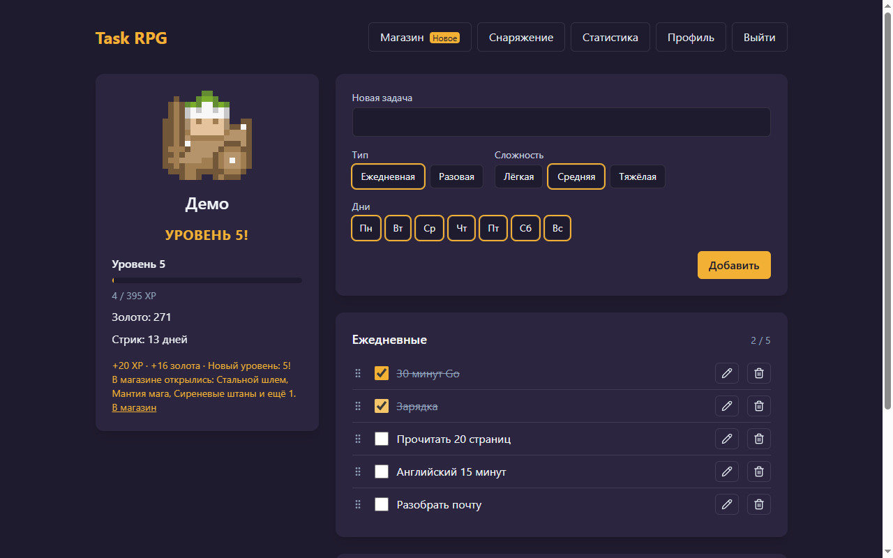
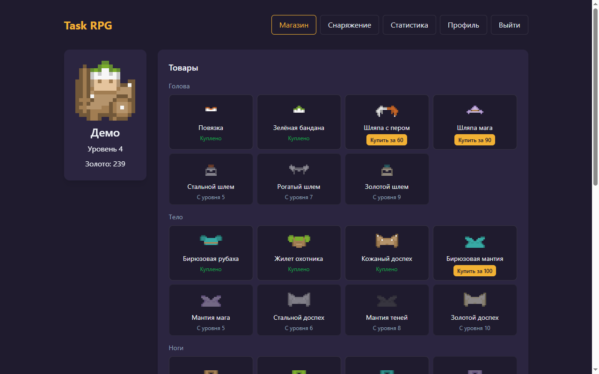
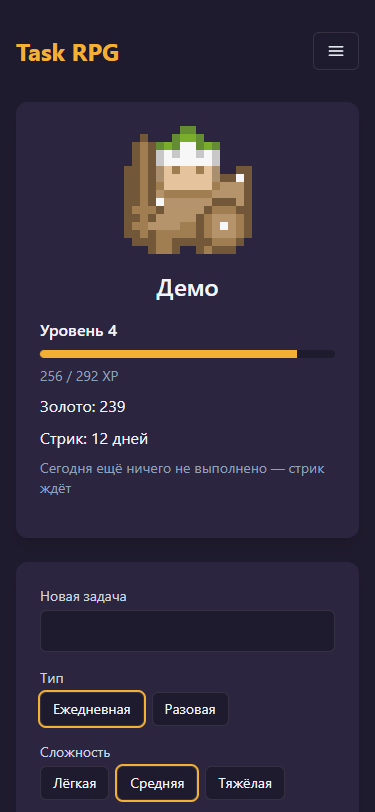
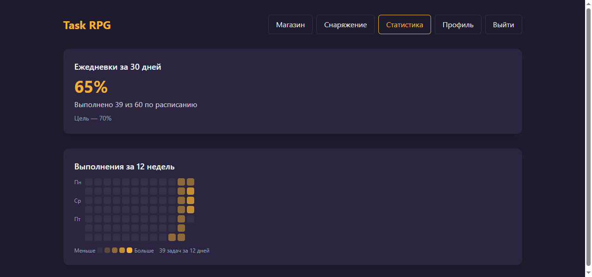
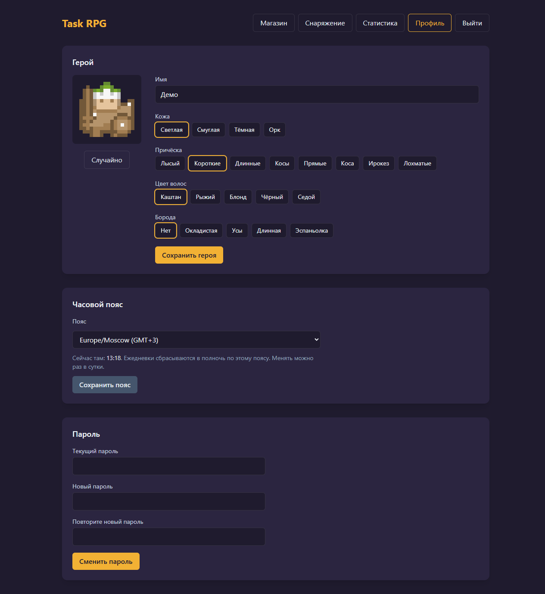
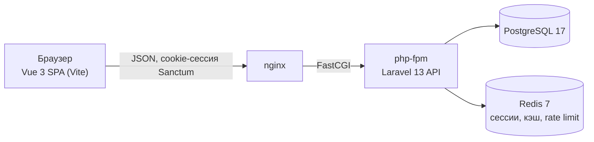

# Task RPG

Трекер задач с прокачкой персонажа: выполняешь ежедневные и разовые задачи, получаешь опыт и золото, персонаж растёт в уровнях и получает экипировку.


Продуктовые требования: [.claude/PRPs/prds/task-rpg.prd.md](.claude/PRPs/prds/task-rpg.prd.md)

## Демо за 5 минут

1. `docker compose up -d`. Первый старт занимает несколько минут: ставятся зависимости и собирается образ.
2. Открой http://localhost:5173 и войди: **`demo@example.com`** / **`demo-password`**.
3. У демо-героя 4-й уровень, стрик 12 дней и купленные вещи. Отметь две ежедневки: над героем всплывёт награда, затем появится «Уровень 5!», а в магазине откроются новые вещи.
4. Зайди в «Магазин», купи «Стальной шлем» и надень его на «Снаряжении». Герой изменится.
5. Загляни в «Статистику» (тепловая карта и доля выполненных ежедневок) и в «Профиль», где меняются внешность героя, часовой пояс и пароль.

Демо создаётся при первом запуске контейнера `app`. Дальше при каждом старте его история только сдвигается к сегодняшнему дню: всё, что ты в нём сделал, сохранится. Как пересоздать его, сказано в разделе «Известные ограничения».

## Возможности

- Регистрация, вход и выход (сессия в cookie через Sanctum SPA), защита от перебора пароля
- Часовой пояс пользователя берётся из браузера при регистрации (принимаются и устаревшие имена вроде `Asia/Calcutta`, которые отдают некоторые браузеры)
- Конструктор персонажа: имя, тон кожи, причёска, цвет волос и борода с живым пиксельным превью
- Профиль: смена имени и внешности героя (прогресс и вещи остаются), часового пояса и пароля. «Сегодня» и сброс ежедневок сразу считаются по новому поясу, но менять его можно не чаще раза в сутки, иначе переходом в пояс, где уже завтра, можно было бы отметить ежедневки дважды. После смены пароля текущая сессия остаётся, а другие устройства выходят из аккаунта
- Главный экран с персонажем и общая шапка на всех страницах героя: логотип ведёт на главную, текущий раздел подсвечен, у «Магазина» метка «Новое», на телефоне меню прячется под бургер (закрывается при переходе и по Esc)
- Ежедневные и разовые задачи: добавление, редактирование, удаление и отметка. Ежедневки сбрасываются в полночь по часовому поясу пользователя, выполненные разовые исчезают со следующего дня
- Сложность задачи (лёгкая ×0.5, средняя ×1, тяжёлая ×2 к награде) и ежедневки по дням недели: в чужой день задача лежит в свёрнутой группе «Не сегодня» и не отмечается. Порядок задач меняется перетаскиванием за ручку или стрелками ↑/↓ и хранится на сервере. Новый игрок видит карточку «С чего начать» с примерами задач
- Снаряжение: 5 слотов (голова, тело, ноги, оружие, щит), стартовый набор у каждого героя, надетые вещи сразу видны на персонаже. Каталог из 32 предметов хранится в БД
- Прогрессия: каждая отметка задачи даёт XP и золото, бонус за стрик растёт день за днём, уровень растёт по кривой с нарастающей сложностью. Снятая галочка забирает ровно то, что дала отметка, и повторная отметка не даёт двойной награды. Награду дают только первые 10 отметок за день, а удаление задачи, отмеченной сегодня, забирает её награду, поэтому прокачку нельзя накрутить. Панель героя на главной показывает уровень, полоску опыта, золото и стрик
- Анимации награды: всплывающее «+XP · +золото» над героем, плавная полоска опыта, баннер и свечение героя при новом уровне. При `prefers-reduced-motion` движения нет, награду по-прежнему объявляет строка для скринридера
- Статистика: тепловая карта выполнений за 12 недель и доля выполненных ежедневок за последние 30 дней с учётом расписания (цель из PRD — 70%)
- Магазин: весь каталог по слотам, покупка за золото, предметы выше уровня видны с пометкой «С уровня N». При повышении уровня строка награды называет открывшиеся вещи, а у ссылки «Магазин» висит метка «Новое», пока игрок туда не заглянет. Купленное остаётся навсегда и надевается на «Снаряжении»

## API

| Метод | Путь | Доступ | Назначение |
|---|---|---|---|
| GET | `/sanctum/csrf-cookie` | все | Выдать CSRF-cookie перед входом или регистрацией |
| GET | `/api/health` | все | Состояние БД и Redis |
| POST | `/api/register` | все | Регистрация и вход |
| POST | `/api/login` | все | Вход (5 неудачных попыток → блокировка на минуту) |
| POST | `/api/logout` | авторизован | Выход |
| GET | `/api/user` | авторизован | Текущий пользователь с персонажем: прогресс (уровень, XP, золото, стрик), экипировка и новые вещи в магазине (`shop.new_items`) |
| PUT | `/api/user/timezone` | авторизован | Сменить часовой пояс (`timezone`). Тот же пояс ничего не меняет; повторная смена раньше чем через 24 часа — 422 с оставшимся временем. В ответе пользователь, посчитанный по новому поясу |
| PUT | `/api/user/password` | авторизован | Сменить пароль (`current_password`, `password`, `password_confirmation`), 204. Другие сессии выходят из аккаунта; 5 попыток в минуту |
| GET | `/api/character` | авторизован | Персонаж пользователя с прогрессом и экипировкой (404, если не создан) |
| POST | `/api/character` | авторизован | Создать персонажа и выдать стартовый набор (409, если уже есть) |
| PUT | `/api/character` | авторизован | Сменить имя и внешность (`name`, `skin_tone`, `hair_style`, `hair_color`, `beard`). XP, золото и вещи не меняются |
| GET | `/api/character/inventory` | авторизован | Вещи героя |
| PUT | `/api/character/equipment/{slot}` | авторизован | Надеть вещь из инвентаря (`item_id`); `slot`: `head`, `body`, `legs`, `weapon`, `shield` |
| DELETE | `/api/character/equipment/{slot}` | авторизован | Снять вещь |
| PUT | `/api/character/shop-seen` | авторизован | Отметить, что магазин открыт: снимает метку «Новое» |
| GET | `/api/stats` | авторизован | `heatmap` — выполнения по дням от понедельника 11 недель назад до сегодня; `dailies` — ежедневки по расписанию за 30 законченных дней: `scheduled`, `completed`, `percent` (`null`, пока ничего не было запланировано) |
| GET | `/api/shop` | авторизован | Каталог с отметками `owned` (куплено) и `unlocked` (уровень позволяет) |
| POST | `/api/shop/purchases` | авторизован | Купить предмет (`item_id`). 422 с причиной: уже куплен, мал уровень или не хватает золота |
| GET | `/api/tasks` | авторизован | Задачи в сохранённом порядке с отметкой «выполнено сегодня» (выполненные разовые скрываются со следующего дня и не считаются в лимит 100). `rewarded_today` — сегодняшняя отметка дала награду, и удаление задачи её заберёт; `scheduled_today` — ежедневка сегодня по расписанию |
| POST | `/api/tasks` | авторизован | Создать задачу (`title`, `type`: `daily` или `todo`, `difficulty`: `easy`, `medium` или `hard`, у ежедневки `weekdays` — ISO-дни 1–7; не больше 100 задач) |
| PUT | `/api/tasks/order` | авторизован | Сохранить порядок (`ids` в новом порядке, 204). Чужой или удалённый id даёт 422 |
| PATCH | `/api/tasks/{id}` | авторизован | Изменить `title`, `difficulty` или `weekdays` (у разовой дней нет) |
| DELETE | `/api/tasks/{id}` | авторизован | Удалить задачу. Отметка за сегодня снимается вместе с наградой, как при снятии галочки; прошлые дни остаются в истории. Ответ как у снятия отметки: `data`, `character`, `reward` |
| PUT | `/api/tasks/{id}/completion` | авторизован | Отметить выполненной и начислить XP и золото (повтор ничего не меняет; ежедневка не по расписанию — 422). Кроме `data` в ответе есть `character` и `reward`; `reward.capped: true` значит, что лимит наград на день исчерпан и отметка засчитана без награды |
| DELETE | `/api/tasks/{id}/completion` | авторизован | Снять отметку за сегодня и забрать её награду (`reward` с минусом) |

Успешные ответы обёрнуты в `{ "data": ... }`, ошибки валидации приходят в стандартном формате Laravel (`message`, `errors`).

## Баланс

Все числа лежат в [backend/config/progression.php](backend/config/progression.php):

- Награда за задачу: 10 XP и 8 золота за среднюю. Лёгкая даёт 50%, тяжёлая 200% (`difficulty`), бонус стрика умножается сверху, округление вниз один раз.
- Дневной лимит: награду дают первые 10 отметок за день пользователя (`rewards.daily_limit`). Остальные засчитываются в стрик без XP и золота. Снятая галочка освобождает место в лимите.
- Стрик: день засчитывается, если выполнена хотя бы одна задача. Пока сегодня ничего не выполнено, стрик не сгорает до конца дня. Каждый день стрика после первого добавляет к награде 10%, максимум +100%, округление вниз.
- Уровни: чтобы перейти с уровня `n` на следующий, нужно `round(45 · n^1.35)` XP (45, 115, 198, 292, 395…). Уровень не хранится в БД, а считается из суммарного XP, поэтому снятая галочка может его понизить.
- Золото и XP не уходят ниже нуля.

Числа подобраны симулятором: он проигрывает игру по настоящим формулам и каталогу и показывает по дням, когда приходит каждый уровень, что он открывает и когда покупается каждая вещь (покупается самая дешёвая доступная, стрик не прерывается):

```bash
docker compose exec app php artisan balance:simulate --tasks=5            # --days=90 --difficulty=medium
```

| Задач в день (средних) | Уровень 5 | Уровень 10 | Весь каталог |
|---|---|---|---|
| 3 | 14-й день | 66-й | 75-й |
| 5 | 10-й | 41-й | 46-й |
| 8 | 7-й | 27-й | 30-й |

Цель «5 задач в день → уровень 10 и весь каталог за 38–50 дней» проверяет тест `BalanceTargetTest`. Остальные тесты считают на зафиксированном эталонном балансе (`tests/TestCase.php`), поэтому подстройка чисел их не трогает.

## Скриншоты

| Новый уровень | Магазин |
|---|---|
|  |  |

| Снаряжение | Телефон (375 px) |
|---|---|
|  |  |

| Статистика | Профиль |
|---|---|
|  |  |

## Архитектура



Контроллеры тонкие: проверяют запрос и отдают ресурс, а правила игры живут в сервисах (`backend/app/Services`):

| Сервис | За что отвечает |
|---|---|
| `UserCalendar` | Единственный источник «сегодня»: полночь по часовому поясу пользователя |
| `TaskCompletionService` | Отметка и её снятие: блокировки, запись выполнения, начисление и возврат награды |
| `RewardService` | Награда с бонусом за стрик, начисление и возврат (не ниже нуля) |
| `StreakService` | Стрик по дням с активностью; сегодняшний день не рвёт серию, пока не кончился |
| `ProgressionService` | Уровень и прогресс из суммарного XP по кривой из конфига |
| `ShopService` | Покупка (уровень, золото, «уже есть») и новые вещи для метки «Новое» |
| `EquipmentService` | Надеть и снять вещь по слотам |
| `StarterKit` | Стартовый набор, идемпотентно |
| `StatsService` | Тепловая карта и доля выполненных ежедневок по расписанию |
| `BalanceSimulator` | Проигрывает прогрессию по настоящим формулам для `balance:simulate` |
| `TimezoneService` | Смена часового пояса с суточным ограничением под блокировкой строки |

Решения, на которых держится доменная логика:

- **Уровень не хранится.** Он вычисляется из XP, поэтому снятая галочка честно его понижает, и рассинхронизации быть не может.
- **Идемпотентность.** Уникальный индекс «задача + день» и блокировка строки задачи: двойной клик не даёт двойной награды. Каждое выполнение помнит, сколько дало, и при снятии забирается ровно столько.
- **Порядок блокировок.** Всегда сначала задача, потом герой. Так параллельные отметки и покупки не устраивают взаимную блокировку.
- **Ограничения в БД.** `CHECK gold >= 0`, уникальные индексы инвентаря и слотов. Даже ошибка в коде не даст уйти в минус или купить вещь дважды.
- **Время в UTC, день — по пользователю.** Задачи сбрасываются в его полночь, тесты двигают время через `travelTo`. Выполнение привязано к дате в календаре пользователя, поэтому смена пояса ограничена: локальные даты всех поясов укладываются в окно примерно в двое суток, и раз в сутки «лишний» день получить нельзя.
- **Смена пароля без своего кода сессий.** Sanctum хранит хеш пароля в сессии и выкидывает сессии со старым хешем, а текущая получает новый в конце того же запроса.

## Стек

| Слой | Технологии |
|---|---|
| Backend | PHP 8.4, Laravel 13 (JSON API), Sanctum |
| Frontend | Vue 3, TypeScript, Vite, Pinia, Vue Router, Tailwind CSS 4 |
| Хранилища | PostgreSQL 17, Redis 7 |
| Окружение | Docker Compose |
| Качество | Pest, Pint, Larastan (level 8), ESLint + Oxlint, Prettier, vue-tsc, Vitest, GitHub Actions |

## Структура

```
task-rpg/
├── backend/            # Laravel API
├── frontend/           # Vue SPA
├── docker/             # Dockerfile, nginx, init-скрипты Postgres
├── .github/workflows/  # CI
└── docker-compose.yml
```

## Запуск

Нужен только Docker.

```bash
docker compose up -d
```

При первом старте контейнер `app` сам выполнит `composer install`, создаст `.env`, сгенерирует ключ, применит миграции, засеет каталог предметов и создаст демо-аккаунт (повторный запуск безопасен, демо не перезаписывается; `SEED_DEMO=false docker compose up -d` его не создаёт, а вне `APP_ENV=local` сид демо пропускается всегда, потому что пароль опубликован здесь), а `frontend` установит npm-зависимости. После обновления репозитория пересобери образ: `docker compose build app`, потому что скрипт запуска копируется в образ. Это занимает несколько минут.

| Что | Адрес |
|---|---|
| SPA | http://localhost:5173 |
| API | http://localhost:8000/api |
| Health check | http://localhost:8000/api/health |
| PostgreSQL | localhost:5432 (`task_rpg` / `secret`) |

## Проверки

Backend (внутри контейнера):

```bash
docker compose exec app composer lint           # Pint
docker compose exec app composer analyse        # Larastan
docker compose exec app composer test           # Pest
docker compose exec app composer test:coverage  # Pest + покрытие (минимум 80%)
```

Frontend (локально, в каталоге `frontend/`, после `npm install`):

```bash
npm run check:lint     # Oxlint + ESLint
npm run check:format   # Prettier
npm run type-check     # vue-tsc
npm run test:ci        # Vitest + покрытие (минимум 80% по всему src/)
npm run build
```

## Известные ограничения

- **Отметить → купить → снять галочку.** Снятие отметки забирает её золото, но не больше, чем есть у героя. Если золото уже потрачено, вещь остаётся, а выигрыш не больше одной награды (от 4 золота за лёгкую задачу до 32 за тяжёлую при максимальном стрике) на покупку. То же при удалении задачи. Снятая отметка освобождает место в дневном лимите, но повторить выигрыш можно только с новой покупкой, а каждую вещь покупают один раз, так что весь выигрыш ограничен каталогом. Для личного трекера это сознательный компромисс: иначе пришлось бы запрещать исправлять ошибочную отметку или уводить золото в минус.
- **Смена пояса туда и обратно.** Игрок, пропустивший вчерашний день, может перейти в пояс, где ещё «вчера», и спасти стрик. Суточное ограничение позволяет это не чаще раза в двое суток, а награду за одну дату задача всё равно даёт один раз. История при смене пояса не пересчитывается: отметки остаются в датах того календаря, в котором были сделаны.
- **После смены пароля «запомнить меня» перестаёт действовать и на текущем устройстве.** Сессия живёт до своего срока, потом нужно войти заново.
- **Демо освежается только при старте контейнера.** При каждом старте `app` история демо сдвигается так, чтобы последний активный день был вчерашним, и всё, что ты в нём сделал, переезжает вместе с ней. Планировщика нет, поэтому если контейнер работает несколько дней без перезапуска, стрик демо прервётся до следующего старта. Пересоздать демо с нуля (другие аккаунты не затрагиваются):

  ```bash
  docker compose exec postgres psql -U task_rpg -d task_rpg -c "delete from users where email = 'demo@example.com'"
  docker compose exec app php artisan db:seed --class=DemoSeeder --force
  ```

## Troubleshooting

- **Порт занят** (5432, 8000 или 5173): задай `FORWARD_DB_PORT`, `APP_PORT` или `FRONTEND_PORT`, например `FORWARD_DB_PORT=5433 docker compose up -d`.
- **Нет тестовой БД `task_rpg_test`**: init-скрипты Postgres выполняются только на пустом volume. Пересоздай его: `docker compose down -v && docker compose up -d`. Осторожно: `-v` удаляет все данные приложения, включая твои задачи и героев.
- **`entrypoint: no such file or directory`**: у `docker/php/entrypoint.sh` переносы строк CRLF. Репозиторий принудительно хранит LF (`.gitattributes`). Пересохрани файл с LF и выполни `docker compose build app`.
- **Медленные ответы API на Windows**: это bind mount Docker Desktop. Помогает перенос репозитория в файловую систему WSL2.
- **419 CSRF token mismatch**: открывай SPA по `http://localhost:5173`, а не `127.0.0.1`. Cookie сессии выдаются для домена `localhost`.

## Ассеты

Спрайты персонажей — [Roguelike Characters](https://kenney.nl/assets/roguelike-characters) от Kenney, лицензия CC0 (`frontend/src/assets/sprites/LICENSE-kenney.txt`).
